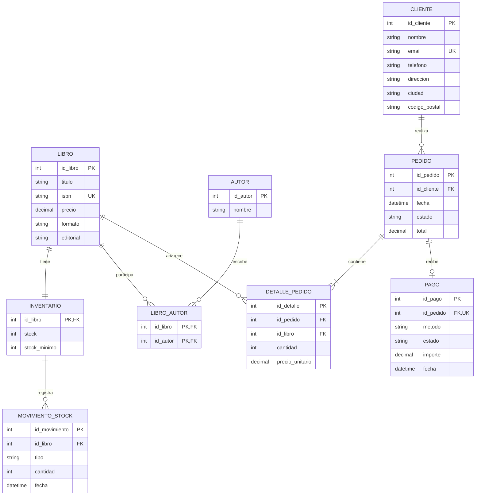

# Diagrama entidad-relación de BookVerse

El modelo contiene nueve tablas y relaciones 1:1, 1:N y N:M.

## Relaciones

- **1:1:** Libro–Inventario y Pedido–Pago.
- **1:N:** Cliente–Pedido, Pedido–Detalle y Libro–Movimientos.
- **N:M:** Libro–Autor mediante Libro_Autor.

El precio unitario se almacena en `detalle_pedido` para conservar el precio histórico de cada compra.
